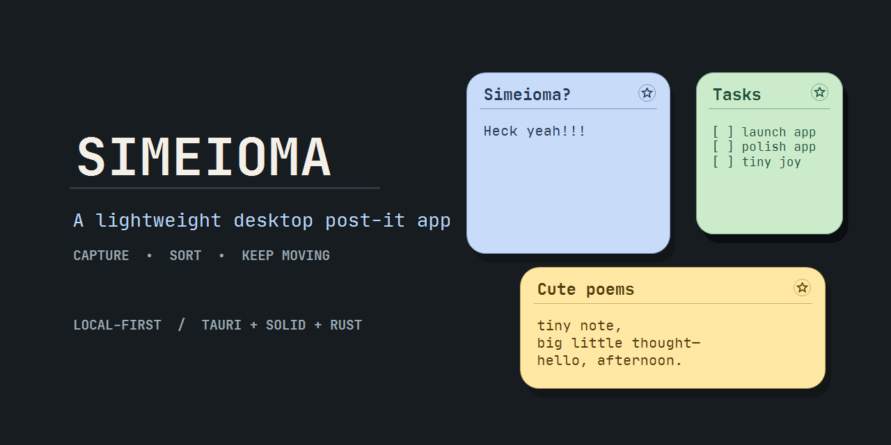

<p align="center">
  
</p>

<p align="center">
  
  
  
  
</p>

# Simeioma

Simeioma is a lightweight cross-platform desktop post-it app for short-lived
office notes, sketches, reminders, and quick capture.

The product goal is simple: a persistent colored strip on the desktop that can
create a focused note in less than a second, without turning quick thoughts into
heavy documents.

## Stack

- Tauri 2 for the native desktop shell and bundling
- Rust for native windows, clipboard/filesystem integration, export, and process control
- Solid + TypeScript for the app interface and source-first editor
- WebView `localStorage` JSON for local note/session persistence
- Tailwind CSS for the styling system
- Bun for dependency management and scripts

## Product Direction

- Persistent note-colored launcher strip near a screen corner
- Hover expansion, instant note creation, and visible-note-aware stacking
- Floating draggable notes with title, color, resize, and adaptive sketch surface
- Source-first `contenteditable` Markdown editing with inline formatting, selection, Cut, and strikethrough support
- Local-first autosave; release sessions retain saved notes but begin with no note windows visible
- Scrollable notes list with contextual note actions and confirmed bulk deletion
- Bulk copy/download as text, Markdown, PNG, or JPEG
- Settings for export path, default copy behavior, reminders, sketching, and keybinds

## Performance Budget

- Cold startup to first usable note: under 1000ms
- Warm startup: under 400ms
- New note creation: under 100ms
- No network calls during startup
- Keep the frontend small and avoid heavy component libraries

## Development

### Prerequisites

The primary development and QA workflow is native Windows. Install:

- [Bun](https://bun.sh/)
- Rust with the Windows MSVC toolchain
- Visual Studio Build Tools with the **Desktop development with C++** workload

Install JavaScript dependencies:

```sh
bun install
```

### Native dev versus release QA

| Mode | Command or artifact | Use it for |
| --- | --- | --- |
| Web frontend only | `bun run dev` | Vite/UI work that does not need Tauri window behavior |
| Native dev | `bun run tauri dev` | The default interactive desktop debugging loop |
| Verbose native dev | `bun run tauri dev --verbose` | Tauri/Rust diagnostics alongside the native app |
| Release QA | `src-tauri/target/release/simeioma.exe` | Persistence, packaging, and stable manual desktop validation |

`bun run tauri dev` starts Vite at `http://localhost:1420` and launches the
native debug shell against it. Frontend changes hot reload; Rust, Tauri config,
permission, and native-command changes may trigger a slower shell rebuild or
restart. Use it to debug launcher behavior, transparent windows, custom popups,
drag/focus behavior, and text selection.

> **Dev-session policy:** launching the dev app intentionally starts from a
> clean note session. It clears saved notes and enables reminders and
> copy-after-save for repeatable debugging. Use the release executable for
> persistence QA or any notes you need to retain.

A debug executable is produced after a native debug build at:

```text
src-tauri/target/debug/simeioma.exe
```

It is not a standalone packaged build: it expects the Vite dev server. Prefer
`bun run tauri dev`; only launch it manually when Vite is already running:

```powershell
bun run dev
.\src-tauri\target\debug\simeioma.exe
```

### Windows release build

Build the frontend alone:

```sh
bun run build
```

Build a Windows release executable and installers:

```sh
bun run build:desktop:windows
```

`scripts/build-windows.ps1` locates Visual Studio Build Tools with `vswhere`,
initializes the x64 MSVC environment, then runs `tauri build`.

Artifacts:

```text
src-tauri/target/release/simeioma.exe
src-tauri/target/release/bundle/msi/Simeioma_1.0.0_x64_en-US.msi
src-tauri/target/release/bundle/nsis/Simeioma_1.0.0_x64-setup.exe
```

If the build fails with `Access is denied` while replacing `simeioma.exe`, close
Simeioma first or stop the running process before rebuilding:

```powershell
Get-Process simeioma -ErrorAction SilentlyContinue | Stop-Process -Force
bun run build:desktop:windows
```

## Debugging and Verification Strategy

Run deterministic checks before considering a change complete:

```sh
bun run test
bun run typecheck
bun run build
cargo check --manifest-path src-tauri/Cargo.toml
```

These cover model behavior, frontend compilation, and Rust/Tauri compilation.
They do not authoritatively prove native window, focus, drag, layout, or WebView
selection behavior. Manual native QA is the source of truth for those contracts.

For a fresh release artifact, test at least:

- launcher creation, drag, hide/restore, and visible-note spawning;
- Markdown selection, strikethrough, Cut, and resize behavior;
- notes-list scrolling, contextual actions, individual deletion, and Delete all;
- saved-note persistence across a release restart and the intentional clean reset
  in dev mode.

See [`docs/TESTING_AND_BEHAVIOR_PLAN.md`](docs/TESTING_AND_BEHAVIOR_PLAN.md) for
the broader behavior ledger and manual test plan.

## License

Copyright (c) 2026 Guilherme Otsugua.

Simeioma is developed as an independent product and research project by Guilherme Otsugua.

Simeioma is licensed under the GNU Affero General Public License v3.0 only (`AGPL-3.0-only`). See [LICENSE](LICENSE).

Commercial/proprietary licenses are available separately. If you want to use Simeioma or derivative work in a closed-source product, hosted service, bundled offering, or other proprietary context, see [COMMERCIAL.md](COMMERCIAL.md).

By contributing to this repository, you agree that your contributions are licensed under `AGPL-3.0-only` and may also be used by the project maintainer under separate commercial license terms. See [CONTRIBUTING.md](CONTRIBUTING.md).
